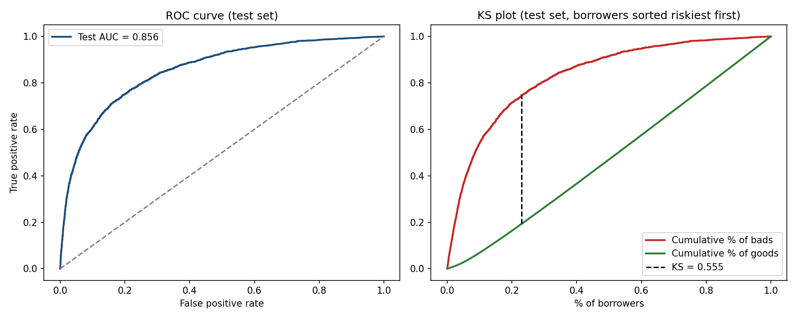
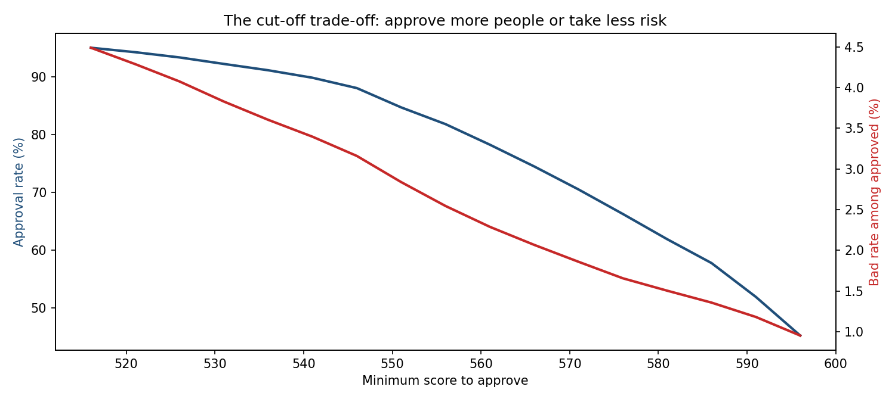
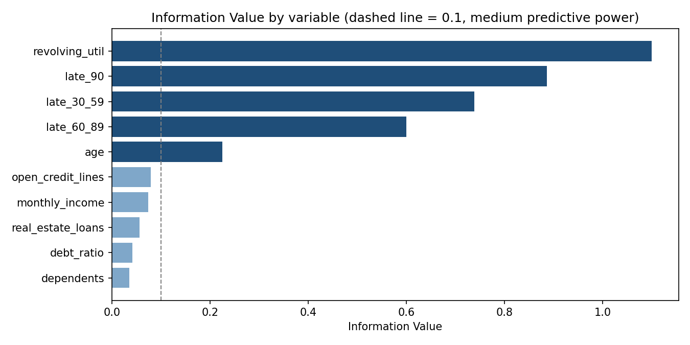
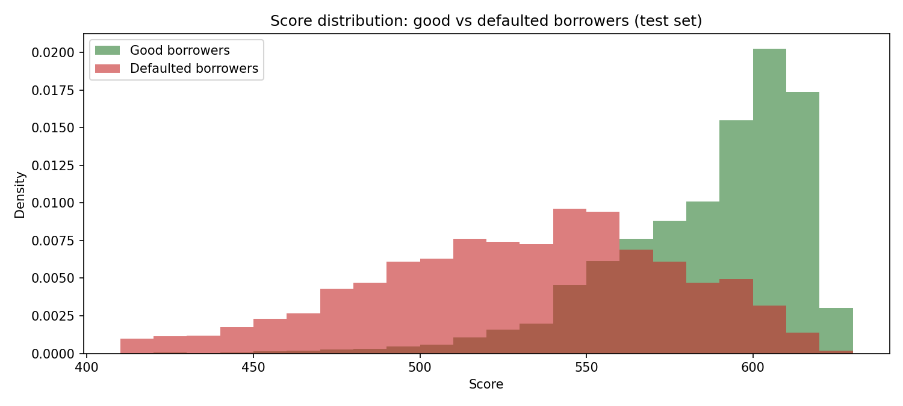

# Credit Scorecard: Predicting Borrower Default

An application scorecard built the way retail banks build them: **Weight of Evidence binning + logistic regression**, validated with **AUC, Gini and KS**, converted into a **points-based scorecard**, and turned into an approval **cut-off decision**.

**Data:** 150,000 borrowers ("Give Me Some Credit", Kaggle). Target: did the borrower become 90+ days past due within 2 years? (6.7% did.)



## Results
| Metric | Train | Test |
|---|---|---|
| AUC | 0.856 | 0.856 |
| **Gini** | 0.711 | **0.712** |
| KS | 0.549 | 0.555 |
| PSI (train vs test) | | 0.0004 (stable) |

Test results match training results, so the model generalizes to borrowers it has never seen.

## Key findings
- **Behavior beats demographics.** Credit utilization (IV 1.10) and past late payments (IV 0.60 to 0.89) are by far the strongest predictors. Age is medium (IV 0.23), income is weak (IV 0.07).
- **Borrowers using more than 90% of their credit lines default 12x more often** than those under 10% (22.3% vs 1.9%).
- **A single past 90-day late payment** raises the default rate from 4.6% to 33.7%.
- **The score separates risk sharply:** the lowest 10% of scores default at 35.8%, the highest 10% at 0.5%.
- **Business trade-off:** with a cut-off at 546 points, the bank approves **88% of applicants**, rejects **58% of future defaulters**, and cuts the default rate among approved borrowers from **6.7% to 3.2%**.



## Method
1. **Cleaning:** removed an impossible age (0), treated the 96/98 error codes in late-payment counts as missing, kept missing income as its own category (missing is often predictive in credit data).
2. **Train/test split:** 70/30, stratified on the target.
3. **Coarse classing:** manual bins per variable, chosen so risk moves in a logical direction.
4. **WoE and IV:** Weight of Evidence per bin, Information Value per variable (calculated on train only, to avoid leakage).
5. **Logistic regression on WoE values.** `open_credit_lines` was **dropped for a wrong-sign coefficient** (positive and not significant), a standard model governance rule.
6. **Validation:** AUC, Gini, KS on train and test, plus Population Stability Index.
7. **Scaling to points:** 600 points = odds of 50:1, 20 points to double the odds (PDO).
8. **Cut-off analysis:** approval rate vs bad rate for each possible minimum score.





## Example: scoring an applicant
A 29-year-old using 85% of their credit, with one 30-day late payment, a 0.45 debt ratio and 2,500 monthly income scores **525 points**, in the riskiest 10% band, where the default rate is about 36%.

The full points table is in `outputs/scorecard.csv`.

## Project structure
```
├── credit_scorecard.ipynb     # full analysis, results visible on GitHub
├── data/cs-training.csv       # source data
├── outputs/
│   ├── scorecard.csv          # points per variable and bin
│   └── cutoff_table.csv       # approval rate vs bad rate by cut-off
├── images/
└── requirements.txt
```

## Tools
Python (pandas, statsmodels, scikit-learn, matplotlib)

## Limitations and next steps
- No application dates, so no **out-of-time validation** (the standard test in banking). A production model would be validated on a later time period.
- Bins are set manually; an automated optimal binning could be compared.
- **Reject inference** is not possible here (we only see approved borrowers).
- Next: add expected loss (PD x LGD x EAD) and monthly monitoring with PSI.
